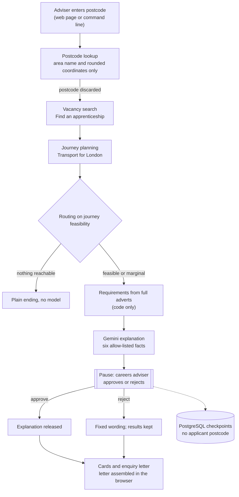

# Apprenticeship Navigator

A demonstration of how to put a language model into a regulated, public-facing service **without letting it carry the risk**. A careers adviser enters a young person's postcode; the service finds apprenticeships nearby, checks the journey to each one, and drafts an explanation that the adviser must approve before anyone relies on it.


> Demonstration interface, not a live service. Runs on your own computer. Coverage is London and nearby only (see Known limits).

## The idea in one paragraph

The model writes one paragraph. Everything that carries risk is ordinary, tested code: journey time limits are fixed numbers shown on screen; the wage line never invents a figure; the postcode is removed before anything reaches the model, the database or the logs; the model receives six approved facts and nothing personal; and a careers adviser approves or rejects the model's text against the facts shown beside it. Code can be tested. A model's sentence can only be reviewed.

## What it shows

| Concern in regulated AI | How this project handles it |
|---|---|
| Data minimisation | Postcode converted to an area name and rounded coordinates before the workflow starts; the model receives six allow-listed fields (title, employer, level, closing date, journey minutes, feasibility); server logs record method, path and status only |
| Human review of model output | The workflow pauses after the model writes. The adviser approves (text released) or rejects (fixed wording, results kept). A decision sent to a run that is not paused is refused (409) |
| Facts by code, not by model | Feasibility, wage, hours, dates, requirements and the enquiry letter are all produced by code and covered by tests |
| Decisions recorded | A written decision record explains each choice, its trade-offs and its cost |
| Failing safely | An outside service failure ends the run with a plain message; a model failure (including a wrong key) falls back to fixed wording and the run continues |

## Architecture

<!-- Check the order of the requirements step against src/apprenticeship_navigator/agents/graph.py before publishing -->



- **Workflow:** LangGraph, with a PostgreSQL checkpointer so a paused run survives a restart.
- **Interfaces:** a command line and a FastAPI service with one static page. Both call the same run functions (`start_run`, `resume_run`).
- **Boundary:** the page receives only the allow-listed applicant view (`RunView`, `VacancyCard`). Contact names, emails, phones and addresses are not declared, so they cannot reach it; tests check this.
- **Enquiry letter:** built by code from the card's facts. Statements about the applicant are left out unless the applicant chooses them, and those choices never leave the browser.

## Before you run it

You need:
- Python 3.12 and [uv](https://docs.astral.sh/uv/)
- Docker with Compose (for the local database)
- A Find an apprenticeship API subscription key (required)
- A Gemini key from Google AI Studio (optional: without it, the explanation step uses fixed wording)
- A LangSmith key (optional: tracing only)

## Running it

```bash
git clone https://github.com/stuartclark-ml/apprentice-triage-app.git
cd apprentice-triage-app
cp .env.example .env          # add your keys; change the database password in both places
docker compose up -d --wait   # local PostgreSQL, data kept in a named volume
```

Command line:

```bash
uv run python scripts/run_agent.py start SW1A1AA
uv run python scripts/run_agent.py resume <run identifier> approve   # or reject
```

Web page:

```bash
uv run uvicorn apprenticeship_navigator.web.app:app
# open http://127.0.0.1:8000
```

Stop the database with `docker compose down` (data kept) or `docker compose down -v` (data deleted).

## Evidence

- **No applicant postcode stored.** After a run, a byte-level search of all three checkpoint tables for the postcode returns 0, 0, 0; the same search for an employer name returns matches, so the search works.
- **Traces:** <!-- add LangSmith shared trace links: one approved run, one rejected run, one plain ending --> (not yet added)
- **Video (3 minutes):** <!-- add link on release --> (not yet added)
- **Tests:** 73 unit tests (`uv run pytest`), plus mypy and ruff, run in continuous integration on every pull request.

## Decision record

<!-- replace with the real path of the decision record -->
See [the decision record](docs/) for: why form fields replaced chat, London-only coverage, data minimisation, the human review pause, why area deprivation is not used in routing, release scope, and cost.

## Known limits

- **London and nearby only:** Transport for London's journey planner cannot plan journeys far outside London.
- **Three vacancies per run.**
- **Employer data is stored in checkpoints** (names, addresses, contact details from adverts). Applicant data is not. Slimming stored vacancies is the first fix after release.
- **No sign-in or adviser identity:** anyone with the page can approve, and the record does not say who approved. A real service needs both.
- **Requirement wording is copied from adverts.** Where an advert lists several subjects on one line, the letter cannot tell whether it means one or all, so its statements say "the advert's requirement of …" rather than claiming specific subjects.

## Version 2 candidates

- Explanation split per vacancy (structured model output), shown beside each card
- Wage and hours among the model's facts
- More than three vacancies, with the word limit scaled
- Requirement lines split into subjects: model proposes, code checks word for word, adviser approves once per advert

## Testing

```bash
uv run pytest
uv run mypy .
uv run ruff check .
```